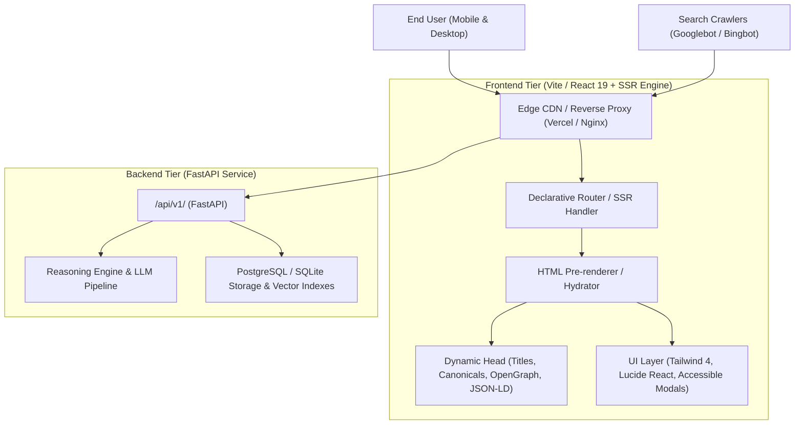

# Technical Architecture — LawerAI
*A project by Maverick Tech Ventures*
*Contact: +923273202419 | ahmedmansoorrind1210@gmail.com*

## 1. System Topology Overview
The LawerAI platform (by Maverick Tech Ventures) is designed as a decoupled, modern web architecture optimized for high-throughput SEO discovery, rapid client-side interactivity, and resilient backend intelligence.



---

## 2. Frontend Architecture & SEO Engine

### 2.1 Rendering Strategy (SSR / SSG / Hydration)
- **Problem**: Client-side-only Single Page Applications (SPAs) delay content rendering for search bots, risk partial indexing, and degrade First Contentful Paint (FCP).
- **Solution**:
  1. Static Site Generation (SSG) / Server-Side Pre-rendering for public landing routes, statutory archives, FAQ pages, and legal resource hubs.
  2. Client-side hydration for dynamic chat sessions, interactive case interviews, and modals.
  3. Dynamic `<head>` management ensuring server-rendered `<title>`, `<meta name="description">`, `<link rel="canonical">`, and `<script type="application/ld+json">`.

### 2.2 Routing & Navigation Architecture
- **Root Router**: Explicit route definitions for all public, functional, and fallback views:
  - `/`: Primary landing page, legal intake hub, statutory fast-lookup, FAQ, and directory.
  - `/statutes`: Searchable statutory database and legal sections.
  - `/directory`: Verified legal counsel directory and contact points.
  - `/privacy` & `/terms`: Compliance and policy pages.
  - `*`: Custom, SEO-compliant 404 handler with HTTP 404 status.
- **Link Integrity Architecture**:
  - Internal navigation managed via semantic `<a href="...">` links with native browser prefetching.
  - No `<button>` masquerading as navigation links; no orphaned `href="#"` or `javascript:void(0)`.
  - Telephone links using RFC 3966 format: `tel:+923273202419`.
  - Email links using RFC 6068 format: `mailto:ahmedmansoorrind1210@gmail.com`.

### 2.3 Component Hierarchy
```
src/
├── components/
│   ├── layout/
│   │   ├── Header.jsx          # Clickable logo, desktop nav, phone/email contact triggers, mobile toggle
│   │   ├── MobileMenu.jsx      # Slide-out drawer with ARIA dialog, trap focus, and mobile-optimized links
│   │   ├── Breadcrumbs.jsx     # Visual + Schema.org BreadcrumbList microdata
│   │   └── Footer.jsx          # Dynamic copyright year, legal links, directory links, sitemap link
│   ├── feedback/
│   │   ├── Toast.jsx           # Global success/info/error toast notifications
│   │   └── AlertBanner.jsx     # Inline contextual success and error banners
│   ├── seo/
│   │   ├── MetaHead.jsx        # Dynamic title, description, canonical, robots noindex/index
│   │   └── StructuredData.jsx  # JSON-LD injector (FAQPage, Organization, BreadcrumbList)
│   ├── pages/
│   │   ├── HomePage.jsx        # Main application intake and statutory search
│   │   └── NotFoundPage.jsx    # Custom 404 page with search and route redirection
│   └── modals/                 # CaseSummary, Emergency, StatuteSearch, Directory
```

---

## 3. Technical SEO Pipeline

### 3.1 Metadata & Schema Architecture
- **Single H1 Policy**: Strict DOM verification enforcing a single, keyword-aligned `<h1>` per view (e.g., `<h1 className="text-3xl font-bold">LawerAI Legal Intelligence & Intake Portal</h1>`).
- **Structured Data (JSON-LD)**:
  - `Organization`: Platform identity, logo, URL, and contact points.
  - `FAQPage`: Rich snippet FAQ schema containing statutory and procedural answers.
  - `BreadcrumbList`: Structured hierarchy linking `/` to deeper categories.
- **Canonical & Robots Controls**:
  - Every page injects an absolute `<link rel="canonical" href="https://lawerai.vercel.app/...">`.
  - Public indexing enabled: `<meta name="robots" content="index, follow, max-snippet:-1, max-image-preview:large, max-video-preview:-1">`.
  - Private/Ephemeral views: `<meta name="robots" content="noindex, nofollow">`.

### 3.2 Crawl Budget & Sitemaps
- **`public/sitemap.xml`**: Auto-generated XML sitemap declaring priority, change frequency, and ISO 8601 `<lastmod>` timestamps.
- **`public/robots.txt`**: Unblocks Googlebot and all legitimate crawlers, specifies sitemap URL, and disallows private backend endpoints (`/api/`, `/admin/`).

---

## 4. Performance & Core Web Vitals Architecture

### 4.1 Asset Optimization Pipeline
- **Next-Gen WebP Formatting**: All raster images compressed and delivered as `.webp`.
- **Layout Shift (CLS = 0)**:
  - All `` tags declare explicit `width` and `height` attributes alongside responsive CSS classes (`h-auto w-full`).
  - Skeleton screens occupy identical bounding dimensions prior to async API responses.
- **Sub-2s Load Strategy**:
  - Critical CSS inlined or preloaded.
  - Lucide icons tree-shaken.
  - Gzip / Brotli compression configured via reverse proxy / hosting layers.
  - Font display swapped (`font-display: swap`) to eliminate FOIT (Flash of Invisible Text).

---

## 5. Mobile & Viewport Architecture
- Strict viewport meta: `<meta name="viewport" content="width=device-width, initial-scale=1.0, maximum-scale=5.0">`.
- Root overflow containment:
  ```css
  html, body {
    overflow-x: hidden;
    max-width: 100vw;
    margin: 0;
    padding: 0;
  }
  ```
- Touch targets: Minimum 48x48 CSS pixels for all interactive icons, buttons, and navigation elements.
